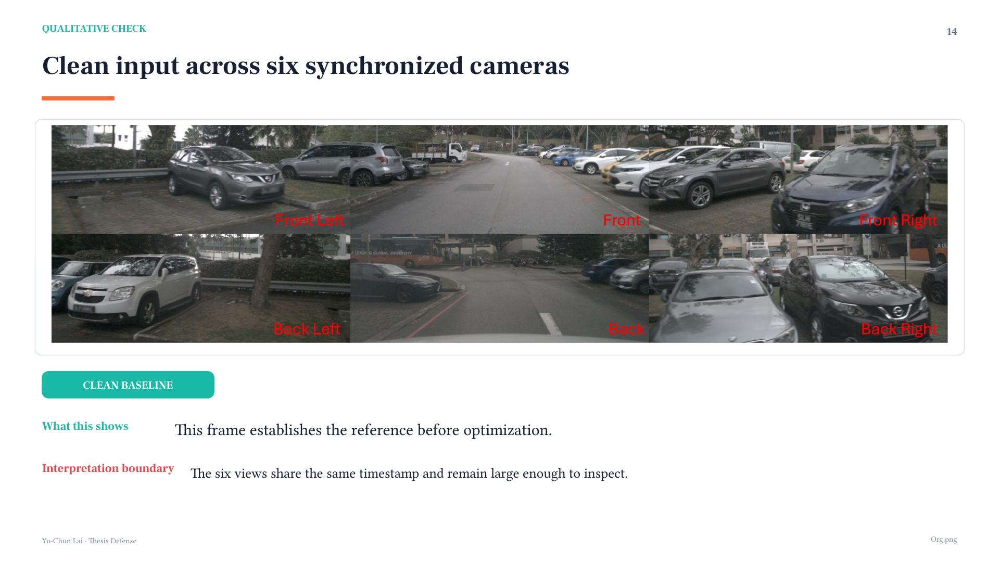
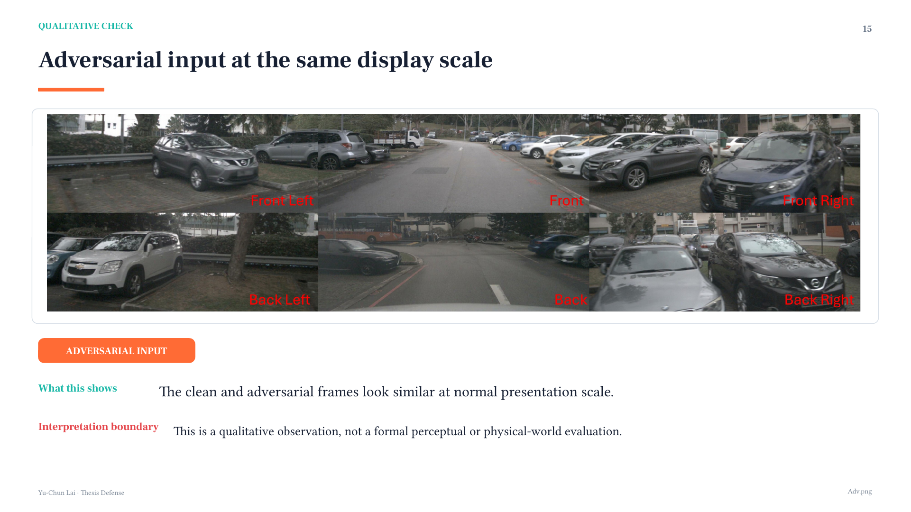
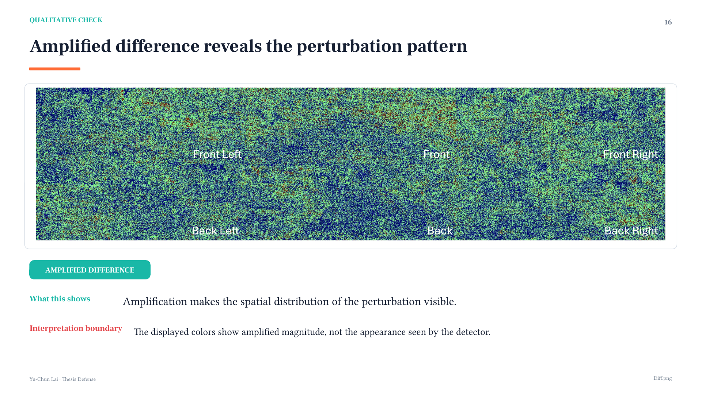
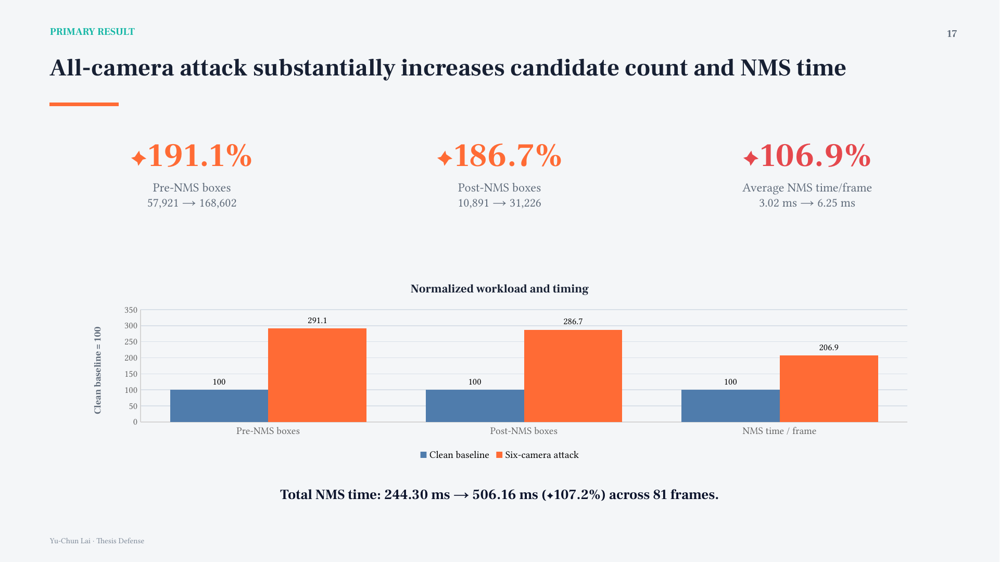
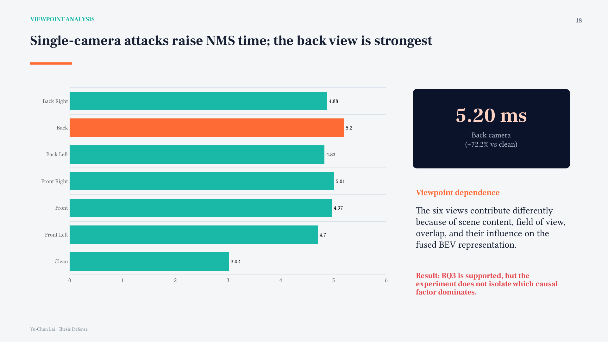
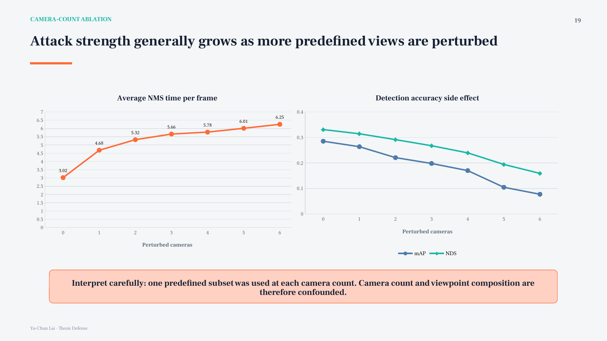
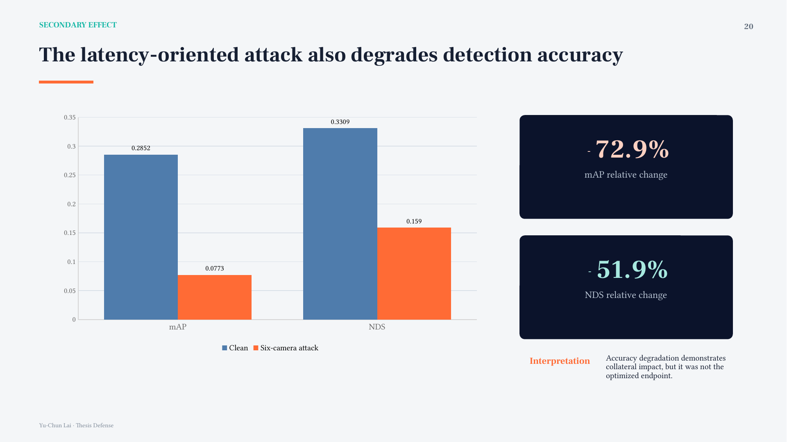

# LatencyAttackBEV

This repository extends [BEVDet](https://github.com/HuangJunJie2017/BEVDet)
with the implementation used in the master's thesis **Adapting
Candidate-Overload Latency Attacks to Multi-Camera BEV-Based 3D Object
Detection**. The project adapts the candidate-overload principle to BEVDet's
multi-camera CenterHead pipeline through Gate-Sum, a differentiable surrogate
defined over class-specific BEV heatmaps.

The attack uses projected gradient ascent to modify selected synchronized
camera views. Gate-Sum promotes confidence growth across dense heatmap
responses, which can cause more decoded candidates to pass filtering and enter
non-maximum suppression (NMS). The main measurement is synchronized task-wise
`nms_gpu()` execution time, not end-to-end inference latency.

## Visualization demo

[](https://youtu.be/epcP8dvvDb8)

The video compares clean and attacked multi-camera inputs, an amplified view
of the image perturbation, and clean versus attacked pre-NMS candidates in
bird's-eye view. The visualization code is intentionally kept separate from
the thesis experiment pipeline on the
[`codex/attack-video-visualization`](https://github.com/YellowElephantHive/LatencyAttackBEV/tree/codex/attack-video-visualization)
branch.

<details>
<summary>Qualitative input comparison</summary>

#### Clean six-camera input



#### Adversarial six-camera input



#### Amplified perturbation



The camera imagery comes from the nuScenes dataset and is shown for
non-commercial research communication. See the
[result figure notice](docs/results/README.md) for provenance and reuse terms.

</details>

### Run the visualization on Palmetto2

Clone the repository and switch to the visualization branch:

```bash
git clone https://github.com/YellowElephantHive/LatencyAttackBEV.git
cd LatencyAttackBEV
git switch codex/attack-video-visualization
```

The visualization job expects an Apptainer image plus an asset directory that
contains the separately distributed `data/` and `checkpoint/` directories.
Set their locations before submitting the job:

```bash
export BEVDET_HOST_ROOT="$PWD"
export BEVDET_ASSET_ROOT=/path/to/bevdet-assets
export BEVDET_CONTAINER=/path/to/bevdet_apptainer.sif
```

Run a two-frame smoke test first:

```bash
BEVDET_VIS_MAX_FRAMES=2 sbatch --export=ALL run_visualization_sbatch
```

After the smoke test succeeds, generate the default 40-frame clip:

```bash
sbatch --export=ALL run_visualization_sbatch
```

PNG frames, candidate-count CSV files, and a manifest are written under
`work_dirs/visualization_<JOB_ID>/`. To encode the frames on a machine with
FFmpeg installed:

```bash
JOB_ID=12345678  # replace with the completed Slurm job ID
ffmpeg -framerate 6 \
  -i "work_dirs/visualization_${JOB_ID}/frames/frame_%06d.png" \
  -c:v libx264 -pix_fmt yuv420p \
  bevdet_candidate_flood.mp4
```

The supplied Slurm job requests one P100 GPU using Palmetto2's resource syntax.
Users of another cluster must adapt the Slurm resource request and filesystem
paths to their environment. P100 execution is for visualization only; its
runtime is not part of the original GTX 1080 Ti thesis results.

## Thesis results

All reported thesis results were measured on **one NVIDIA GeForce GTX 1080 Ti**
using 81 synchronized multi-camera frames from the nuScenes-mini validation
split. The detector was BEVDet-STTiny with fixed pretrained weights. The
primary attack modified all six camera views using `eps=0.03137` (approximately
8/255), `alpha=0.003922` (approximately 1/255), 20 steps, `tau=0`, and
`kappa=20`.

### Clean baseline and six-camera attack

| Metric | Clean | Six-camera attack | Change |
| --- | ---: | ---: | ---: |
| Frames | 81 | 81 | - |
| Task-wise NMS calls | 486 | 486 | - |
| Pre-NMS boxes | 57,921 | 168,602 | +191.1% |
| Post-NMS boxes | 10,891 | 31,226 | +186.7% |
| Total NMS time | 244.30 ms | 506.16 ms | +107.2% |
| Average NMS time per frame | 3.02 ms | 6.25 ms | +106.9% |
| mAP | 0.2852 | 0.0773 | -0.2079 |
| NDS | 0.3309 | 0.1590 | -0.1719 |



### Camera-count ablation

Each column uses one predefined camera subset. The experiment does not average
over every combination of a given size, so camera count and viewpoint
composition are not fully separated.

| Attacked cameras | Clean | 1 | 2 | 3 | 4 | 5 | 6 |
| --- | ---: | ---: | ---: | ---: | ---: | ---: | ---: |
| Pre-NMS boxes | 57,921 | 98,526 | 127,487 | 137,242 | 142,075 | 154,819 | 168,602 |
| Average NMS time/frame (ms) | 3.02 | 4.68 | 5.32 | 5.66 | 5.78 | 6.01 | 6.25 |
| mAP | 0.2852 | 0.2638 | 0.2210 | 0.1980 | 0.1701 | 0.1047 | 0.0773 |
| NDS | 0.3309 | 0.3144 | 0.2915 | 0.2676 | 0.2396 | 0.1943 | 0.1590 |

All six single-camera attacks increased candidate count and NMS time relative
to the clean baseline. Among the evaluated viewpoints, the back camera produced
the largest workload: 125,211 pre-NMS boxes and 5.20 ms average NMS time per
frame. The front-left camera produced the smallest single-view increase: 98,666
pre-NMS boxes and 4.70 ms per frame.

Detection degradation is a secondary observation. Gate-Sum does not optimize
an accuracy loss directly.

<details>
<summary>Viewpoint, camera-count, and accuracy charts</summary>

#### Single-camera viewpoint analysis



#### Camera-count ablation



#### Detection accuracy side effect



</details>

## Repository layout

```text
tools/run_bevdet_experiment.py       Modular experiment entrypoint
tools/bevdet_experiment/             Attack, hooks, counting, timing, and losses
tools/bevdet_experiment/tests/       CPU unit tests for the modular components
experiments/bevdet_attack/           Shared parameters, camera matrices, and checks
run_baseline_sbatch                  Clean evaluation
run_overload_sbatch                  Six-camera Gate-Sum attack
run_cam_count_sbatch                 One predefined subset for each camera count
run_single_cam_position_sbatch       Six independent single-camera experiments
test_bevdet_modules_sbatch           CPU unit tests inside Apptainer
```

The four root `run_*_sbatch` files are the official experiment entrypoints.
Historical research scripts and the frozen legacy implementation are not part
of the published experiment interface.

## Environment

The codebase follows the original BEVDet/MMDetection3D 0.18.1 environment. The
included [Dockerfile](docker/Dockerfile) pins the main legacy dependencies:

- Python environment from `pytorch/pytorch:1.6.0-cuda10.1-cudnn7-devel`
- MMCV 1.3.8
- MMDetection 2.17.0
- MMSegmentation 0.18.0
- MMDetection3D 0.18.1
- nuScenes devkit 1.1.9

Build the image with:

```bash
docker build -t latency-attack-bevdet -f docker/Dockerfile .
```

The image provides the legacy dependency environment. Mount this checkout at
`/mmdetection3d` to run the thesis code:

```bash
docker run --rm -it \
  --gpus all \
  --ipc=host \
  -v "$PWD:/mmdetection3d" \
  latency-attack-bevdet \
  /bin/bash
```

The thesis runs used an Apptainer image on Clemson Palmetto2. Cluster-specific
paths are centralized in
[`experiments/bevdet_attack/common.sh`](experiments/bevdet_attack/common.sh)
and can be overridden through environment variables.

## Data and checkpoint placement

Datasets, checkpoints, logs, and generated results are intentionally excluded
from Git. After downloading the separately distributed files, use this layout:

```text
checkpoint/
└── bevdet-sttiny-pure.pth

data/
└── nuscenes_adv_patch/
    ├── nuscenes_infos_val.pkl
    └── samples/

logs/       # Slurm stdout and stderr
work_dirs/  # Candidate-count CSV files and experiment outputs
```

The checkpoint is distributed separately through Google Drive. The repository
keeps the directory structure but does not include the model weights or
nuScenes data.

To prepare BEVDet4D metadata for nuScenes-mini from a standard nuScenes-mini
installation, run:

```bash
python tools/data_converter/prepare_nuscenes_for_bevdet4d_mini.py
```

## Validate the experiment configuration

Run the shell-level dry checks before submitting jobs:

```bash
bash experiments/bevdet_attack/check.sh
```

This checks shell syntax, camera matrices, command counts, attack parameters,
and the generated commands against the golden command snapshot.

Run the modular CPU tests on Palmetto2 with:

```bash
sbatch test_bevdet_modules_sbatch
```

The test job covers CLI parsing, camera and ROI selection, hooks, heatmap and
depth objectives, geometry losses, and proposal regularization.

## Run the experiments

### Clean baseline

```bash
sbatch run_baseline_sbatch
```

### Six-camera Gate-Sum attack

```bash
sbatch run_overload_sbatch
```

The `overload` filename is historical. This job uses the Gate-Sum objective
with all six cameras.

### Camera-count ablation

```bash
sbatch run_cam_count_sbatch
```

The selected camera subsets are defined in
[`camera_count.tsv`](experiments/bevdet_attack/camera_count.tsv).

### Single-camera viewpoint ablation

```bash
sbatch run_single_cam_position_sbatch
```

Camera indices and names are defined in
[`single_camera.tsv`](experiments/bevdet_attack/single_camera.tsv).

## Palmetto2 path overrides

The default paths reproduce the thesis project layout:

```text
Repository: /project/xiaoyon/trustai/lai/BEVDet
Container:  /project/xiaoyon/trustai/lai/bevdet_apptainer.sif
```

For another checkout or container location:

```bash
BEVDET_HOST_ROOT=/scratch/$USER/BEVDet \
BEVDET_CONTAINER=/path/to/bevdet.sif \
sbatch --export=ALL run_overload_sbatch
```

The Slurm files retain Palmetto's historical `gtx_1080` resource label for
thesis reproducibility. The thesis identifies the physical evaluation GPU as
an NVIDIA GeForce GTX 1080 Ti.

Palmetto2 no longer advertises GTX 1080 nodes. During the modular-code cleanup
on November 5, 2026, a P100 override was used only to verify that the refactored
entrypoint could start, finish, and produce logs and CSV output:

```bash
sbatch --gpus-per-node=p100:1 run_overload_sbatch
```

This P100 run is not part of the thesis or defense-slide experiments. No P100
timing appears in the result tables above, and its timing must not be compared
with or substituted for the GTX 1080 Ti thesis results.

## Outputs

| Job | Primary output |
| --- | --- |
| Baseline | `work_dirs/cnt_clean_<JOB_ID>.csv` |
| Six-camera attack | `work_dirs/cnt_gate_<JOB_ID>.csv` |
| Camera-count ablation | `work_dirs/cnt_attack_<N>cams_<JOB_ID>.csv` |
| Single-camera ablation | `work_dirs/cnt_single_cam_<INDEX>_<NAME>_<JOB_ID>.csv` |
| All jobs | stdout and stderr under `logs/` |

The CSV instrumentation records task-wise candidate counts around NMS. The
timing hook synchronizes the GPU immediately before and after each `nms_gpu()`
call. It does not measure end-to-end inference or vehicle-control latency.

## Scope and limitations

- The reported results cover 81 nuScenes-mini frames, one BEVDet-STTiny
  configuration, and one GTX 1080 Ti execution environment.
- The study evaluates an offline digital white-box attack. It does not establish
  physical-world or black-box feasibility.
- The camera-count experiment uses one predefined subset at each size, so its
  trend also reflects viewpoint composition.
- Candidate growth and synchronized NMS timing support the proposed mechanism
  for this configuration; they do not establish universality across BEV models
  or hardware platforms.

For lower-level job configuration and dry-run details, see
[`experiments/bevdet_attack/README.md`](experiments/bevdet_attack/README.md).

---

## Upstream BEVDet


 

## News
* **2022.06.01** We release the code and models of both BEVDet and BEVDet4D!
* **2022.04.01** We propose BEVDet4D to lift the scalable BEVDet paradigm from the spatial-only 3D space to the spatial-temporal 4D space. Technical report is released on arixv. \[[BEVDet4D](https://arxiv.org/abs/2203.17054)\].
* **2022.04.01** We upgrade the BEVDet paradigm with some modifications to improve its performance and inference speed. **Thchnical report of BEVDet has been updated.** \[[BEVDetv1](https://arxiv.org/abs/2112.11790)\].
* **2021.12.23** BEVDet is now on arxiv. \[[BEVDet](https://arxiv.org/abs/2112.11790)\].

## Main Results
| Method            | mAP      | NDS     | FPS    |   Download |
|--------|----------|---------|--------|-------------|
| [**BEVDet-Tiny**](configs/bevdet/bevdet-sttiny.py)   | 30.8     | 40.4    | 15.6   | [google](https://drive.google.com/file/d/10innSxqN7NgbktrlfPjWjE7gz-xpbJO_/view?usp=sharing) / [baidu](https://pan.baidu.com/s/1DBxJXgtrW1_7McPSM_koyA?pwd=tbac) / [log](https://pan.baidu.com/s/1DnnBmoP3_sHayxTpOLUy5A?pwd=9uxh)        |
| [**BEVDet4D-Tiny**](configs/bevdet4d/bevdet4d-sttiny.py) | 33.8     | 47.6    | 15.5   | [google](https://drive.google.com/file/d/1nyQfp7Gt-xbXDzcw5ritmFb8lvPM1H6n/view?usp=sharing) / [baidu](https://pan.baidu.com/s/1n9sVR6FnfmMccSJFTsVKfw?pwd=nzi1) / [log](https://pan.baidu.com/s/1VlvLSRPSBRw1EoYvSC3WAA?pwd=e4h1)        |
## Get Started
##### Please follow the guidelines in the original mmdet3d for preparing the repo and dataset.

Please see [getting_started.md](docs/getting_started.md) for the basic usage of MMDetection3D. We provide guidance for quick run [with existing dataset](docs/1_exist_data_model.md) and [with customized dataset](docs/2_new_data_model.md) for beginners. There are also tutorials for [learning configuration systems](docs/tutorials/config.md), [adding new dataset](docs/tutorials/customize_dataset.md), [designing data pipeline](docs/tutorials/data_pipeline.md), [customizing models](docs/tutorials/customize_models.md), [customizing runtime settings](docs/tutorials/customize_runtime.md) and [Waymo dataset](docs/datasets/waymo_det.md).

##### Prepare dataset specific for BEVDet4D.
Note: Make sure that data preparation in [nuscenes_det.md](docs/datasets/nuscenes_det.md) has been conducted.
```shell
cd BEVDet/
python tools/data_converter/prepare_nuscenes_for_bevdet4d.py
```
##### Visualize the predicted result with open3d.
Note: make sure that you conduct the visualization locally instead of on the remote server.
```shell
cd BEVDet/
python tools/test.py $config $checkpoint --show --show-dir $save-path
```
## Acknowledgement
This project is not possible without multiple great open-sourced code bases. We list some notable examples below.
* [open-mmlab](https://github.com/open-mmlab)
* [CenterPoint](https://github.com/tianweiy/CenterPoint)
* [Lift-Splat-Shoot](https://github.com/nv-tlabs/lift-splat-shoot)
* [Swin Transformer](https://github.com/microsoft/Swin-Transformer)

Beside, there are some other attractive works extend the boundary of BEVDet.
* [BEVerse](https://github.com/zhangyp15/BEVerse)  for multi-task learning.
* [BEVFusion](https://github.com/mit-han-lab/bevfusion)  for acceleration, multi-task learning, and multi-sensor fusion. (Note: The acceleration method is a concurrent work of that of BEVDet and has some superior characteristics like memory saving and completely equivalent.)

## Bibtex
If this work is helpful for your research, please consider citing the following BibTeX entry.
```
@article{huang2022bevdet4d,
  title={BEVDet4D: Exploit Temporal Cues in Multi-camera 3D Object Detection},
  author={Huang, Junjie and Huang, Guan},
  journal={arXiv preprint arXiv:2203.17054},
  year={2022}
}

@article{huang2021bevdet,
  title={BEVDet: High-performance Multi-camera 3D Object Detection in Bird-Eye-View},
  author={Huang, Junjie and Huang, Guan and Zhu, Zheng and Yun, Ye and Du, Dalong},
  journal={arXiv preprint arXiv:2112.11790},
  year={2021}
}
```
